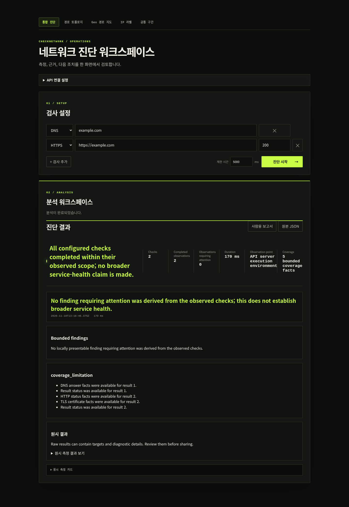
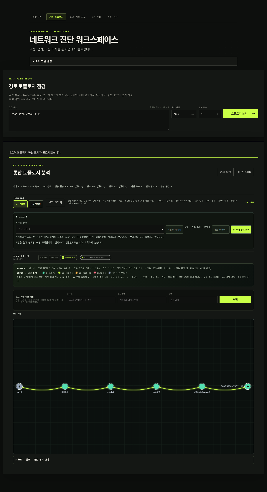
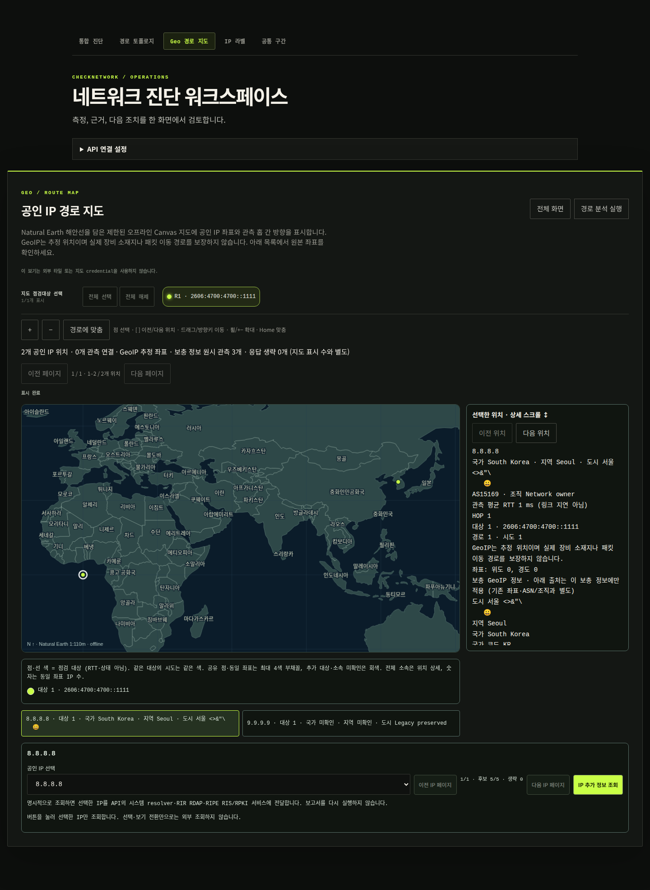
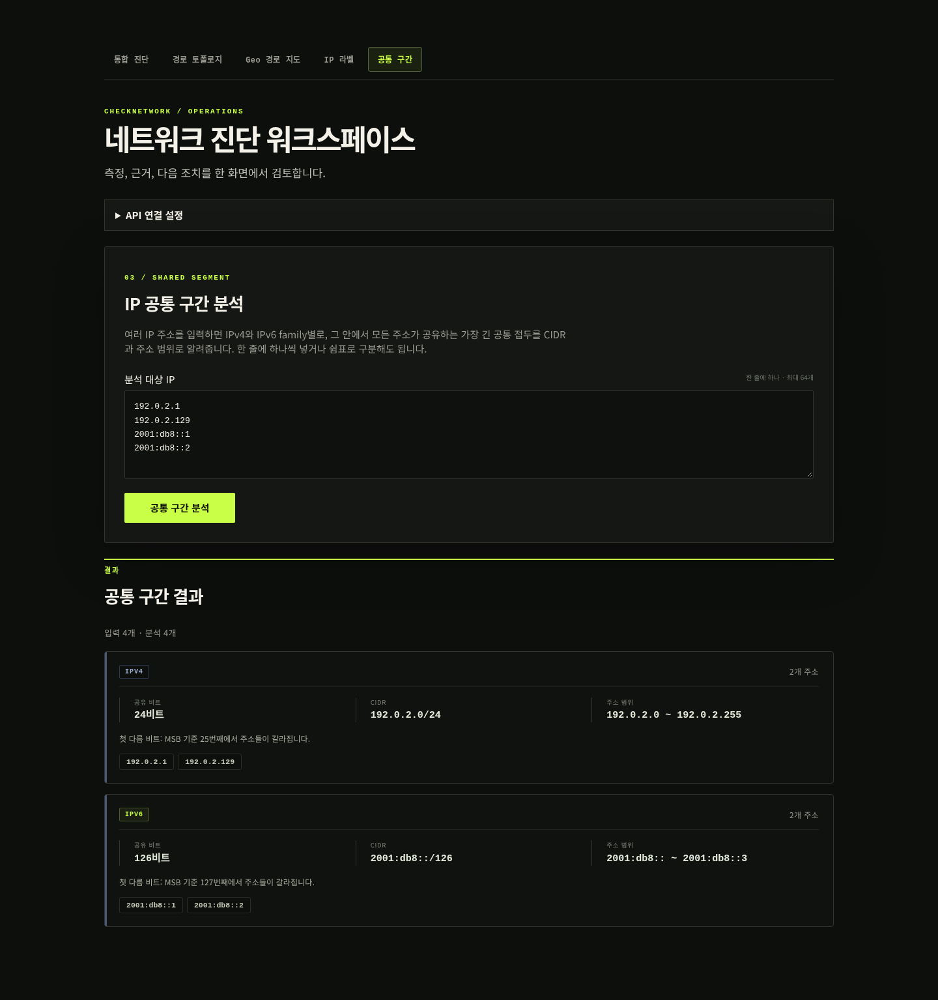

# CheckNetwork

[한국어](README.md) · [API](docs/API.md) · [Architecture](docs/ARCHITECTURE.md) · [Contributing](CONTRIBUTING.md) · [Security](SECURITY.md)

A Go diagnostic API with a static Web workspace and an Android client. It checks DNS, TCP, HTTP(S), traceroute and server-first SSH/mail greetings, then presents observations, evidence and safe next steps.

## Server-side measurements

Checks run on the API server, not inside the browser or Android device. A remote API does not directly measure the user's Wi-Fi or mobile-carrier path. Analysis confidence describes the strength of evidence, not the probability of a root cause. An unanswered traceroute hop is not sufficient evidence of a broken link; Geo/ASN context does not establish device location or ownership.

The source VERSION is `0.1.0`; this is not a claim that a release/tag has been published. Hosted CI enforcement, exact-SHA release verification and physical-platform acceptance remain separate gates. The project is licensed under [Apache-2.0](LICENSE); publishing a release still requires separate approval.

## Docker Compose quick start

Requires Docker daemon, Compose and access to the pinned image sources. Default host ports are loopback-only.

```sh
# Run from the repository root after checking for existing port conflicts.
docker compose up --build --wait
curl --fail http://127.0.0.1:8090/readyz
curl --fail http://127.0.0.1:8090/api/v1/health
```

Browser: `http://localhost:3000`. API: `http://localhost:8090`. Container API port: 8080. `CHECKNETWORK_API_PORT=18090 docker compose up --build --wait` changes both the host publication and the Web build-time API default, so rebuild the Web image when changing it.

`/livez` checks process liveness; `/readyz` includes startup traceroute capability and draining; `/api/v1/health` reports build identity. A successful health response does not prove readiness or release provenance.

## Go + static Web quick start

Requires Go 1.22+ (the verified CI toolchain is Go 1.26.11), Python 3 and a supported platform traceroute executable. Missing/failed startup traceroute capability makes readiness return 503.

```sh
# Terminal 1: default API bind is 127.0.0.1:8080.
GOTOOLCHAIN=go1.26.11 go run ./cmd/checknetwork-api
```

```sh
# Terminal 2: bind the static server narrowly as well.
python3 -m http.server 3000 --bind 127.0.0.1 --directory frontend
```

Open `http://localhost:3000`, expand API connection settings and set `http://localhost:8080`. Static/canonical Web defaults to port 9090, direct Go to 8080 and default Compose to 8090. If port 3000 is occupied, select another Web port and set the matching `CHECKNETWORK_ALLOWED_ORIGINS`.

```sh
# Terminal 3: actual report request; individual failed checks are still observations.
curl --fail -X POST http://127.0.0.1:8080/api/v1/reports \
  -H 'Content-Type: application/json' \
  -d '{"timeout_ms":5000,"targets":[{"kind":"dns","address":"example.com"},{"kind":"https","address":"https://example.com"}]}'
```

## Typical workflows

| Symptom | Checks | Interpretation |
|---|---|---|
| Hostname cannot be reached | DNS plus TCP to the endpoint | Separate resolver observations from endpoint connection failures. |
| HTTPS fails | HTTPS, optionally TCP 443 | Distinguish certificate/trust/hostname errors from connection and response-read failures. Do not disable verification as a fix. |
| Route appears unstable | Repeated traceroute and target filtering | Review completed attempts, unavailable observations and limitations before attributing a failure. |

Service checks observe server-first greetings only; they do not test authentication, commands, STARTTLS, mailboxes or end-to-end transactions. Human reports are the default review surface; raw JSON requires privacy care.

## Web workspace

The UI provides integrated diagnostics, 2D/optional 3D topology, an offline Geo map, local IP labels and local common-prefix CIDR/range calculations. 2D/3D modes project the same facts and do not change diagnosis. A common prefix does not prove an observed common route segment.









Screenshot sources, hashes and reproduction conditions are recorded in [screenshot provenance](docs/images/PROVENANCE.md). Fixture replay screenshots demonstrate the UI, not successful live external diagnostics or a deployed release. Earlier stage counts and the pre-existing common-route draft are preserved in [implementation history](docs/IMPLEMENTATION-HISTORY.md).

## Android

Requires JDK 17, Android platform 35 and build-tools 35.0.0. Environment verification does not automatically install these dependencies.

```sh
# Prepare JDK/SDK first; invoke from the repository root.
make android-wrapper-verify
make android-env
make android-test
make android-lint
make android-assemble
```

A device's localhost is the device itself: configure a reachable API explicitly. Public credentials require HTTPS. Debug and release network policies differ. Raw JSON sharing uses a confirmed private-cache content URI; the process-observed lease cannot forcibly expire an already opened descriptor or a recipient's copy. Physical-device/TalkBack acceptance is separate from JVM tests.

## Deployment security

`trusted-local` is unauthenticated and permits private-network checks. Non-loopback direct binding requires exact `CHECKNETWORK_EXPOSE_TRUSTED_LOCAL=yes`, but acknowledgement is not authentication or a firewall. Use `public` mode, an API key, a positive rate limit and a TLS reverse proxy for exposed access. CORS is not authentication. Backend rate limiting uses the actual connection IP, so clients behind one proxy share its quota. See [SECURITY.md](SECURITY.md) and [operations](docs/OPERATIONS.md).

## Development

```sh
# Node 22+, Go and Docker Compose CLI are required; Full also needs Android tooling.
export GOTOOLCHAIN=go1.26.11
make ci-quick
make ci-workflows
make ci-security
make ci
```

See [CI](docs/CI.md), [testing](docs/TESTING.md), [verification evidence](docs/PHASE2-VERIFICATION.md), [plan](PLAN.md) and [changelog](CHANGELOG.md). Local automation does not establish hosted required-check enforcement, exact-SHA release reproducibility or physical Chrome/Firefox/Safari, screen-reader, Android and TLS-proxy acceptance.
