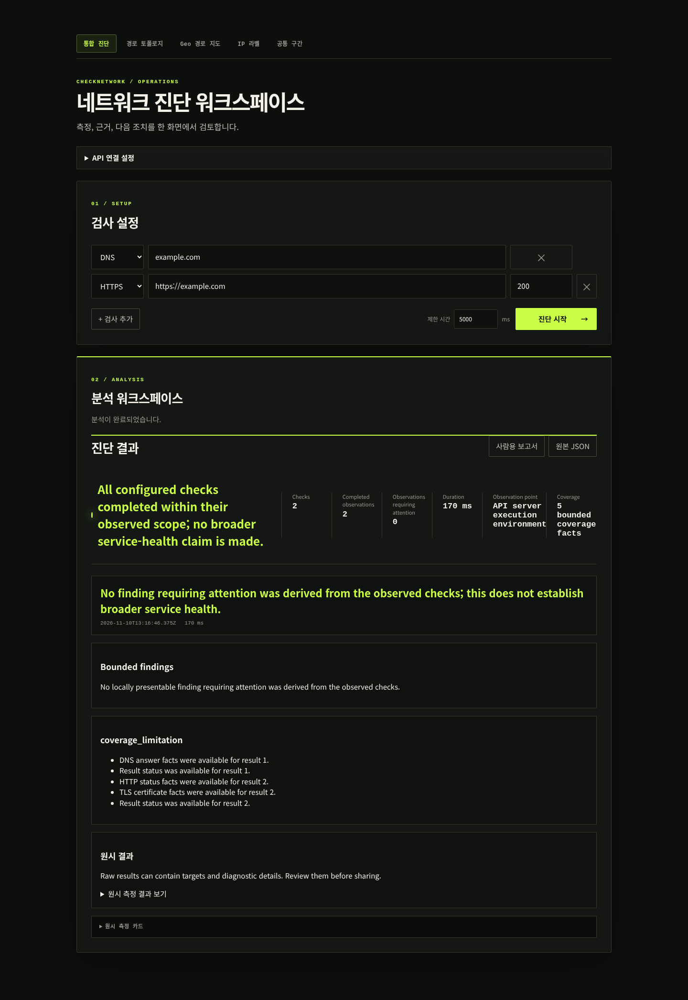
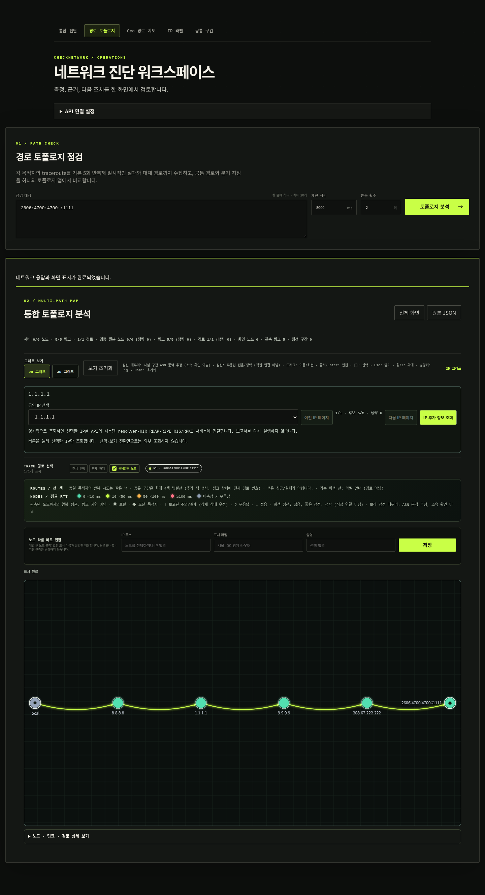
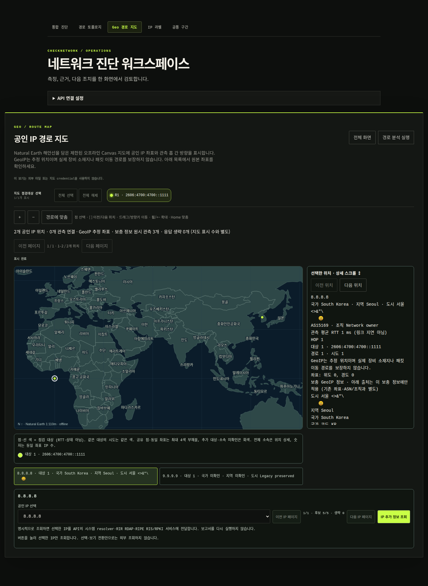
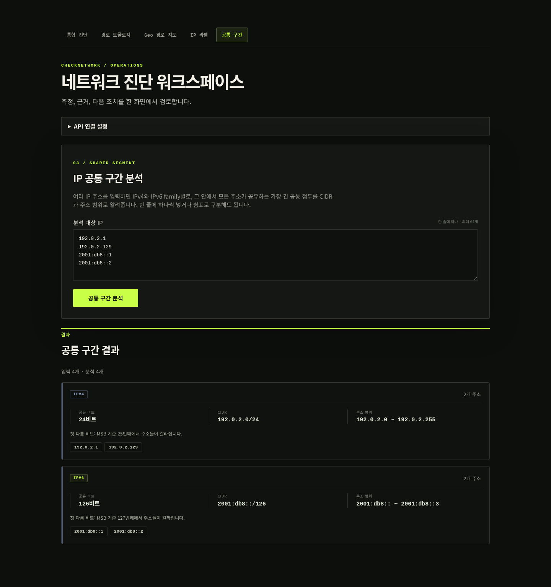

# CheckNetwork

CheckNetwork는 네트워크 연결 문제를 확인하고, 관측 결과를 바탕으로 원인 후보와 다음 점검 방법을 보여주는 도구입니다. 웹이나 Android 앱에서 DNS, TCP, HTTP(S), 경로 추적과 서비스 응답을 검사할 수 있습니다.

실제 검사는 **API 서버가 실행되는 네트워크**에서 수행합니다. 원격 서버에 연결한 경우, 결과를 내 PC나 휴대전화에서 직접 측정한 값으로 해석하면 안 됩니다.

## 무엇을 할 수 있나요?

| 화면·기능 | 확인할 수 있는 내용 |
| --- | --- |
| 통합 진단 | 연결 상태, DNS 조회, HTTP 응답, TLS 인증서, SSH·메일 서비스의 초기 응답 |
| 경로 토폴로지 | 목적지까지 응답한 홉과 연결 관계를 2D/3D 그래프로 확인, 대상별 선택과 노드 이동 |
| Geo 경로 지도 | 공인 IP의 추정 위치, 대상별 색상, 위치·사업자·관측 지연 상세 |
| IP 추가 정보 조회 | 선택한 공인 IP의 PTR, 등록 정보, BGP 대역·ASN, RPKI 상태 |
| IP 라벨 | IP에 별칭을 붙이고 CSV/JSON으로 가져오기 |
| 공통 구간 | IPv4/IPv6 주소가 공유하는 접두사와 주소 범위를 계산. 서버 요청 없음 |
| 보고서 | 사람이 읽는 요약과 원본 JSON을 별도로 내려받기 |

웹은 정적 HTML/CSS/JavaScript, API는 Go로 구성되어 있습니다. Android 앱은 같은 API를 사용하며, 대화형 그래프 대신 경로 요약과 IP 상세 정보를 제공합니다.

## 빠른 시작

아래 두 방법 중 하나를 선택하세요. 명령은 저장소 루트에서 실행합니다.

### Docker Compose로 실행

Docker와 Compose 플러그인이 필요합니다. 처음 실행할 때 이미지를 내려받고 빌드합니다.

```bash
docker compose up --build --wait
```

브라우저에서 `http://localhost:3000`을 여세요. API 주소는 `http://localhost:8090`입니다. 기본 설정은 두 서비스 모두 내 컴퓨터에서만 접속할 수 있도록 제한합니다.

API가 준비됐는지 확인하려면:

```bash
curl --fail http://localhost:8090/readyz
```

이 Compose 구성으로 시작한 서비스를 종료하려면 `docker compose down`을 실행합니다.

### 소스에서 직접 실행

Go 1.22 이상과 Python 3가 필요합니다. 경로 추적에는 운영체제의 `traceroute` 계열 도구도 필요합니다. 웹 화면을 실행하는 데 Node.js나 별도 프론트엔드 빌드는 필요하지 않습니다.

첫 번째 터미널에서 API를 실행합니다.

```bash
# 보안 수정 툴체인을 명시해 실행한다.
GOTOOLCHAIN=go1.26.11 go run ./cmd/checknetwork-api
```

두 번째 터미널에서도 저장소 루트를 기준으로 웹 서버를 실행합니다.

```bash
python3 -m http.server 3000 --bind 127.0.0.1 --directory frontend
```

`http://localhost:3000`을 열고, **API 연결 설정 → API 주소**를 `http://localhost:8080`으로 바꾸세요.

| 실행 방법 | 웹 주소 | 사용할 API 주소 |
| --- | --- | --- |
| Docker Compose 기본값 | `http://localhost:3000` | `http://localhost:8090` |
| 소스 직접 실행 | `http://localhost:3000` | `http://localhost:8080` |

정적 HTML에 들어 있는 초기 API 주소는 `http://localhost:9090`이므로 직접 실행할 때는 위 설정이 필요합니다. Compose는 빌드할 때 API 주소를 맞춥니다. `CHECKNETWORK_API_PORT`로 Compose 포트를 바꿨다면 웹 이미지도 다시 빌드하세요.

## 처음 사용하는 순서

1. **통합 진단**에서 검사 종류와 대상 주소를 입력하고 **진단 시작**을 누릅니다. 한 번에 최대 20개 대상을 검사할 수 있습니다.
2. 결과 요약에서 관측된 문제, 원인 후보, 다음 확인 방법을 읽습니다. 필요한 경우 개별 결과를 펼쳐 확인합니다.
3. **경로 토폴로지**에서 목적지와 반복 횟수를 정해 경로를 검사합니다. 2D/3D 전환이나 대상 선택은 이미 받은 결과를 표시하는 방식만 바꿉니다.
4. **Geo 경로 지도**에서 대상별 경로를 선택하고 지도 점이나 위치 목록을 눌러 상세 정보를 봅니다. 배경 지도는 외부 지도 타일이나 API 키 없이 표시됩니다.
5. 공인 IP의 등록·라우팅 정보를 더 보려면 **IP 추가 정보 조회**를 누릅니다. 이 조회 때문에 진단을 다시 실행하지는 않습니다.

### IP 추가 정보는 무엇인가요?

| 정보 | 뜻 |
| --- | --- |
| PTR·정방향 확인 | IP에 연결된 DNS 이름과, 그 이름을 조회했을 때 원래 IP가 나오는지 확인 |
| RDAP | IP 대역의 등록기관, 등록 범위, 조직 및 등록·변경 시각 |
| BGP·ASN | 외부 라우팅 관측에서 확인한 IP 대역과 이를 알리는 네트워크 번호 |
| RPKI | 해당 네트워크가 그 대역을 알릴 권한이 있는지 확인 |

이 정보는 조회 버튼을 눌렀을 때만 요청합니다. 화면을 열거나 IP를 선택하는 것만으로는 요청하지 않습니다. API는 선택한 IP를 DNS 해석기·등록기관·RIPE 서비스에 조회하며, 화면에 출처와 조회 시각, 정보 없음 또는 실패 상태를 함께 표시합니다. 추가 조회 결과는 기존 보고서나 내보내기에 자동으로 넣지 않습니다.

일반 경로 검사에 포함되는 GeoIP·ASN 보강은 위 버튼 조회와 별개입니다. 오프라인 배경 지도를 사용하더라도 IP 메타데이터 조회에는 외부 공급자가 사용됩니다.

## 결과 읽는 법

- 정상 결과는 수행한 검사 범위에서의 정상입니다. SSH·메일 검사의 초기 응답이 정상이어도 로그인, 메일 송수신 또는 서비스 전체 동작을 확인한 것은 아닙니다.
- 원인 후보와 신뢰 수준은 관측 근거의 정도입니다. 확정된 원인이나 장애 확률이 아닙니다.
- 홉의 무응답만으로 장애 위치를 단정하지 마세요. 연속 무응답 홉을 접거나 숨겨도 뒤에서 응답한 홉은 유지하며, 생략 구간 연결은 직접 관측한 연결과 구분합니다.
- RTT는 왕복 응답 시간입니다. 지도 좌표는 GeoIP 추정치이며 실제 장비 위치를 보장하지 않습니다. 같은 좌표의 IP가 같은 장비라는 뜻도 아닙니다.
- PTR 이름, 등록 국가, RPKI 정상 상태는 개인 신원·실제 위치·IP의 안전성을 증명하지 않습니다. BGP 정보도 직접 측정한 패킷 경로와 다릅니다.
- 생략 수와 실패 안내를 함께 읽으세요. 큰 보고서는 서버와 화면의 제한에 따라 일부만 표시할 수 있습니다.

## Android 앱

Android 8.0(API 26) 이상을 지원합니다. 빌드에는 JDK 17, Android SDK 35, Build-Tools 35.0.0이 필요합니다.

Android Studio에서 `android/`를 열거나 저장소 루트에서 다음 명령을 실행하세요.

```bash
make android-env
make android-assemble
```

디버그 앱의 에뮬레이터 기본 API 주소는 `http://10.0.2.2:8080`입니다. 위의 소스 직접 실행 방식과 연결할 때 사용하는 주소입니다. 릴리스 앱은 유효한 HTTPS API 주소가 필요하며, 서명·배포 설정은 별도로 해야 합니다.

설정, 공유 방식과 실기기 주의사항은 [Android 안내](android/README.md)를 참고하세요.

## API 호출 예시

API만 사용할 수도 있습니다. 다음 예시는 소스로 직접 실행한 API에서 DNS와 HTTPS를 검사합니다. Compose를 사용한다면 포트를 `8090`으로 바꾸세요.

```bash
curl --fail http://localhost:8080/api/v1/health

curl --fail -X POST http://localhost:8080/api/v1/reports \
  -H 'Content-Type: application/json' \
  -d '{
    "targets": [
      {"kind": "dns", "address": "example.com"},
      {"kind": "https", "address": "https://example.com"}
    ]
  }'
```

응답 구조, 인증과 오류 코드는 [API 명세](docs/API.md)에 정리되어 있습니다.

## 연결이 안 될 때

| 증상 | 먼저 확인할 것 |
| --- | --- |
| 웹은 열리지만 API 요청이 실패함 | 실행 방식에 맞는 API 포트인지, API 프로세스가 실행 중인지 확인 |
| 주소를 바꾼 뒤 브라우저에서만 실패함 | `CHECKNETWORK_ALLOWED_ORIGINS`에 실제 웹 주소가 허용되어 있는지 확인 |
| `401` 오류 | 공개 API 인증 설정과 Bearer 키 확인 |
| `429` 오류 | 요청 제한 안내에 따라 기다린 뒤 재시도 |
| `/readyz`에 `traceroute_unavailable` 표시 | 서버의 경로 추적 도구 설치·실행 가능 여부 확인. API 시작 시 실행 검사를 수행함 |
| 지도에 특정 IP가 없음 | 공인 IP이며 유효한 좌표가 있는지 확인. 좌표 없는 IP를 임의로 지도에 배치하지 않음 |

기본 `trusted-local` 모드는 사설망 진단을 허용하므로 그대로 인터넷에 공개하지 마세요. 외부 공개 시에는 `public` 모드, API 키, 요청 제한, HTTPS 설정이 필요합니다. CORS 허용만으로 접근을 인증할 수는 없습니다. 자세한 설정은 [운영 문서](docs/OPERATIONS.md)를 참고하세요.

원본 JSON에는 IP와 경로 등 네트워크 정보가 들어갈 수 있습니다. 공유 전에 내용을 확인하세요.

## 개발 및 테스트

Go/Web 테스트에는 Go와 Node.js 22 이상, npm, `make`가 필요합니다. 아래 명령은 저장소 루트에서 실행합니다.

```bash
# CI와 같은 보안 수정 툴체인을 사용한다.
export GOTOOLCHAIN=go1.26.11
npm --prefix frontend ci
make test             # Go/Web 테스트 및 Android 환경 탐색 스크립트 검사
make web-test-syntax  # JavaScript 문법 검사
make test-race        # Go 동시성 검사
make vet              # Go 정적 검사
make build            # bin/checknetwork-api 생성
```

Android 환경까지 준비했다면 `make android-check`로 Android 테스트·lint·APK 빌드를 실행할 수 있습니다. `make ci`는 Go/Web와 Android를 함께 검증합니다.

자동 테스트 통과와 실제 배포·실기기·스크린 리더 검증은 구분합니다. 브라우저 테스트와 릴리스 검증의 준비 조건 및 명령은 [테스트 기준](docs/TESTING.md)에 있습니다.

## 문서 안내

| 알고 싶은 내용 | 문서 |
| --- | --- |
| Android 설정과 빌드 | [Android 안내](android/README.md) |
| 요청·응답과 오류 코드 | [API 명세](docs/API.md) |
| 실행 설정, 보안, 자원 제한, 배포 | [운영 문서](docs/OPERATIONS.md) |
| 구성 요소와 처리 흐름 | [아키텍처](docs/ARCHITECTURE.md) |
| 지도 사용과 GeoIP 정보의 한계 | [Geo 지도](docs/GEO-MAP.md), [Geo 상세 계약](docs/GEO-DETAILS.md) |
| IP 추가 정보 조회의 동작과 개인정보 처리 | [Web](docs/IP-CONTEXT-WEB.md), [Android](docs/IP-CONTEXT-ANDROID.md), [백엔드 계약](docs/IP-CONTEXT.md) |
| 테스트 실행과 아직 검증하지 않은 범위 | [테스트 기준](docs/TESTING.md) |
| 구현 이력과 남은 검증·개선 항목 | [구현 이력](docs/IMPLEMENTATION-HISTORY.md) |
| 이전 README의 내부 계약·검증 기록 | [기술 참고 문서](docs/README-TECHNICAL-NOTES.md) |
[English](README.en.md) · [사용/운영](docs/OPERATIONS.md) · [API](docs/API.md) · [기여](CONTRIBUTING.md) · [보안](SECURITY.md)

[](https://github.com/piecer/revealnetworktrouble/actions/workflows/ci.yml)

DNS·TCP·HTTP(S)·traceroute·SSH/메일 계열 상태를 검사하고 관측 증거와 다음 점검 단계를 보고하는 Go API + Web + Android 앱이다.

중요: 검사는 API 서버 측에서 실행된다. 브라우저나 Android가 연결한 원격 서버의 관측이지, 사용자 기기의 Wi-Fi·통신사 경로를 직접 측정한 결과가 아니다. `confidence`도 장애 원인 확률이 아니라 수집한 근거의 수준이다.

소스 버전은 `VERSION`의 `0.1.0`이다. 이 값만으로 공개 릴리스/태그 발행이나 지원 플랫폼 검증 완료를 뜻하지 않는다. CI 배지도 원격 workflow 반영·실행 후의 상태를 표시하며 로컬 통과 결과를 대신하지 않는다. 프로젝트 라이선스는 [Apache-2.0](LICENSE)이며 공개 배포 승인은 별도다.

## 빠른 시작: Docker Compose

필요: Docker daemon, Compose 및 이미지 다운로드 접근. 기본 설정은 개발용이며 API/Web의 host publish는 loopback으로 제한된다.

```sh
# 저장소 루트에서 실행한다. 사용 중인 서비스/포트와 충돌하지 않는지 먼저 확인한다.
docker compose up --build --wait
# API 기본 host port는 8090, Web은 3000이다.
curl --fail http://127.0.0.1:8090/readyz
curl --fail http://127.0.0.1:8090/api/v1/health
```

브라우저에서 `http://localhost:3000`을 연다. API 기본 주소는 `http://localhost:8090`이다. `/livez`는 프로세스 생존, `/readyz`는 traceroute capability와 drain을 포함한 준비 상태, `/api/v1/health`는 build identity다. health 한 경로의 성공을 전체 readiness와 혼동하지 않는다.

다른 API host port가 필요하면 `CHECKNETWORK_API_PORT=18090 docker compose up --build --wait`처럼 설정한다. API publish와 Web build-time 기본값이 함께 바뀌므로 Web 재빌드가 필요하다. 컨테이너 내부 API port는 8080이다.

## 빠른 시작: Go + 정적 Web

필요: Go 1.22 이상(검증 툴체인은 Go 1.26.11), Python 3, platform traceroute 실행 파일. traceroute가 없거나 startup loopback probe가 실패하면 `/readyz`는 503이며 기능을 준비 완료로 간주하지 않는다. 시스템 패키지 설치는 해당 OS의 검증된 패키지 경로를 사용한다.

```sh
# 터미널 1: 이 명령에만 검증 툴체인을 적용한다. 기본 API bind는 127.0.0.1:8080이다.
GOTOOLCHAIN=go1.26.11 go run ./cmd/checknetwork-api
```

```sh
# 터미널 2: 정적 파일 서버도 loopback으로 제한한다.
python3 -m http.server 3000 --bind 127.0.0.1 --directory frontend
```

`http://localhost:3000`의 `API 연결 설정`을 열어 `http://localhost:8080`으로 바꾼다. 정적 HTML/Compose 밖 canonical Web의 초기 주소 9090, 직접 Go 실행의 8080, 기본 Compose의 8090은 서로 다르다. 이미 port 3000이 사용 중이면 다른 Web port와 그에 맞는 `CHECKNETWORK_ALLOWED_ORIGINS`를 사용한다.

```sh
# 터미널 3: 실제 API 요청. 결과에는 개별 검사의 실패도 정상적인 관측으로 포함될 수 있다.
curl --fail http://127.0.0.1:8080/readyz
curl --fail -X POST http://127.0.0.1:8080/api/v1/reports \
  -H 'Content-Type: application/json' \
  -d '{"timeout_ms":5000,"targets":[{"kind":"dns","address":"example.com"},{"kind":"https","address":"https://example.com"}]}'
```

## 사용 시나리오

| 상황 | 먼저 실행할 검사 | 해석과 다음 단계 |
|---|---|---|
| 이름으로 접속되지 않음 | DNS와 같은 대상의 TCP | DNS 관측 실패와 endpoint 연결 실패를 분리한다. resolver/주소/정책을 확인한다. |
| HTTPS만 실패 | HTTPS, 필요하면 TCP 443 | 인증서 만료·hostname·trust와 연결/응답 실패를 구분한다. 인증서 검증을 끄는 것을 해결책으로 삼지 않는다. |
| 경로가 불안정해 보임 | traceroute 반복·목적지 필터 | 무응답 홉을 즉시 장애로 단정하지 않는다. completed/실패 attempt와 관측 한계를 함께 확인한다. |

서비스 검사는 server-first greeting 관측이며 로그인·메일 송수신·STARTTLS·end-to-end 성공을 검증하지 않는다. 원본 JSON보다 사람용 보고서와 구조화된 analysis를 먼저 읽는다.

## 화면과 지원 기능

통합 진단, 기본 2D/선택 가능한 3D 경로 토폴로지, offline Geo 지도, IP 라벨 import/편집, IP family별 공통 CIDR/주소 범위 계산을 제공한다. 2D/3D는 같은 facts의 보기이며 진단 결과를 바꾸지 않는다. Geo/ASN은 등록 정보 기반 추정치다. `공통 구간`의 CIDR 일치만으로 실제 공통 네트워크 경로나 동일 장비를 확정하지 않는다.









그림의 실행 출처·해시·재현 조건은 [화면 검증 기록](docs/images/PROVENANCE.md)에 있다. fixture 재생 화면은 UI 예시이지 외부 네트워크 진단 성공이나 운영 이미지 검증 증거가 아니다. 사전 README의 추가 공통 경로 알고리즘 설명과 Stage별 수치는 [구현 이력](docs/IMPLEMENTATION-HISTORY.md)에 보존했다.

## Android 빠른 시작

필요: JDK 17, Android platform 35, build-tools 35.0.0. Wrapper 검증/환경 검사기는 자동 설치기가 아니다. [환경 설정](docs/OPERATIONS.md)을 먼저 따른다.

```sh
# JDK/SDK를 준비한 후 저장소 루트에서 실행한다.
make android-wrapper-verify
make android-env
make android-test
make android-lint
make android-assemble
```

debug는 개발용 네트워크 정책, release는 더 엄격한 정책을 사용한다. 단말의 localhost는 단말 자신이므로 별도의 API 호스트 설정이 필요하다. public credential에는 HTTPS가 필요하다. 기본 공유는 redacted human summary이고 원본 JSON은 경고 확인 후 private-cache content URI로 공유한다. 실기기/TalkBack·프로세스 종료 후 descriptor 동작은 별도 acceptance다.

## 보안 배포

`trusted-local`은 무인증이며 사설망 진단을 허용한다. 직접 실행 시 loopback 밖 bind는 정확한 `CHECKNETWORK_EXPOSE_TRUSTED_LOCAL=yes` 승인과 WARN이 필요하지만 이 승인은 인증·방화벽이 아니다. 공개 접근에는 `public`, API key, 양수 rate limit 및 TLS reverse proxy를 사용한다. CORS는 인증이 아니며 proxy 뒤 backend quota는 실제 연결 source IP 기준으로 공유된다. [보안 정책](SECURITY.md)과 [배포 경계](docs/OPERATIONS.md)를 확인한다.

## 개발·검증

```sh
# Node 22+, Docker Compose CLI, Go를 준비한다. 전체 CI에는 Android 환경도 필요하다.
export GOTOOLCHAIN=go1.26.11
make ci-quick
make ci-workflows
# 도구와 의존성 취약점·secret·보안 회귀를 검사한다.
make ci-security
# Android를 포함한 전체 로컬 gate다.
make ci
```

Offline archive validators: API 34 + Web 30 = 64. 이 수치는 archive fixture 계층이며 전체 테스트 수가 아니다. 실행 결과와 미검증 범위는 [Phase 2 검증](docs/PHASE2-VERIFICATION.md), [테스트 기준](docs/TESTING.md), [CI 절차](docs/CI.md)를 따른다. 로컬 자동화는 실제 브라우저·screen reader·Android 실기기·TLS proxy·정확한 SHA의 릴리스를 대신하지 않는다.

[현재 아키텍처](docs/ARCHITECTURE.md) · [실행 계획](PLAN.md) · [구현 이력](docs/IMPLEMENTATION-HISTORY.md) · [변경 기록](CHANGELOG.md)
